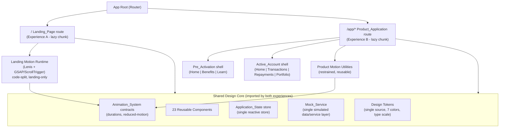
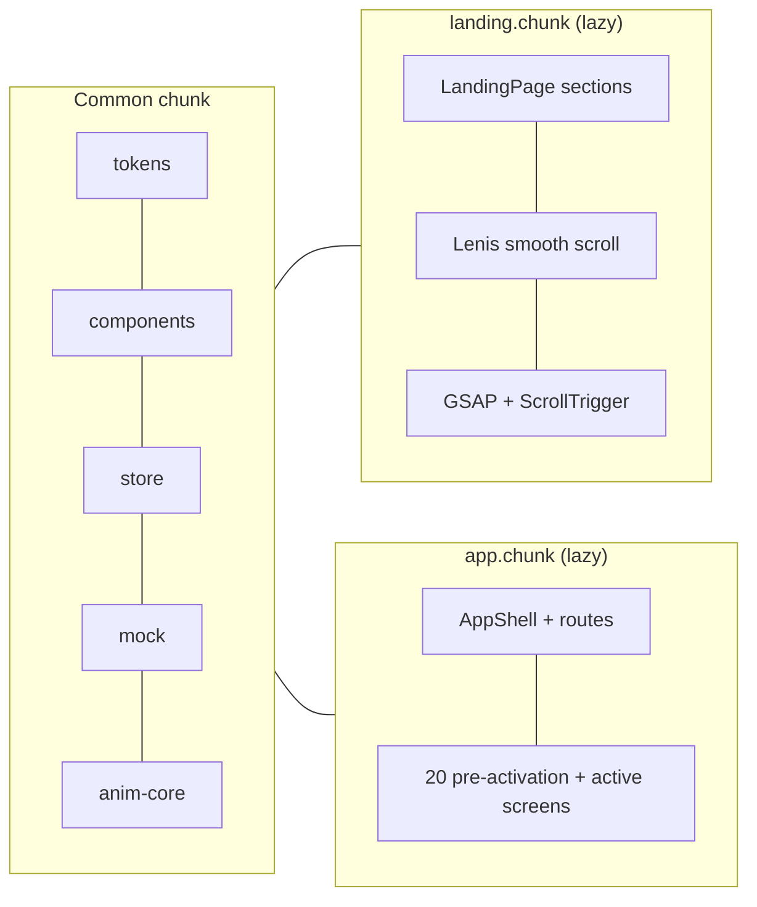
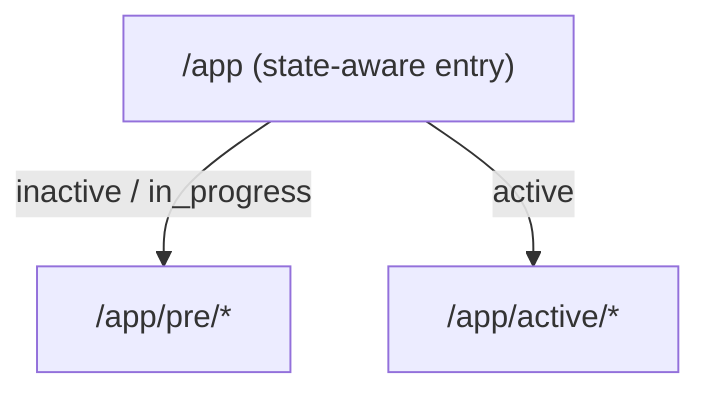
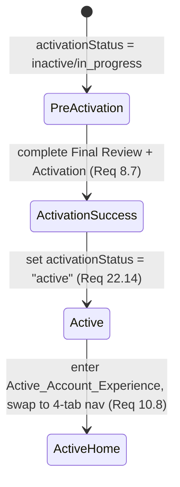
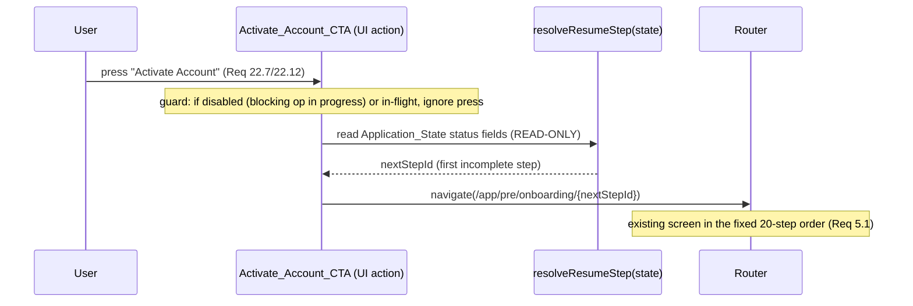
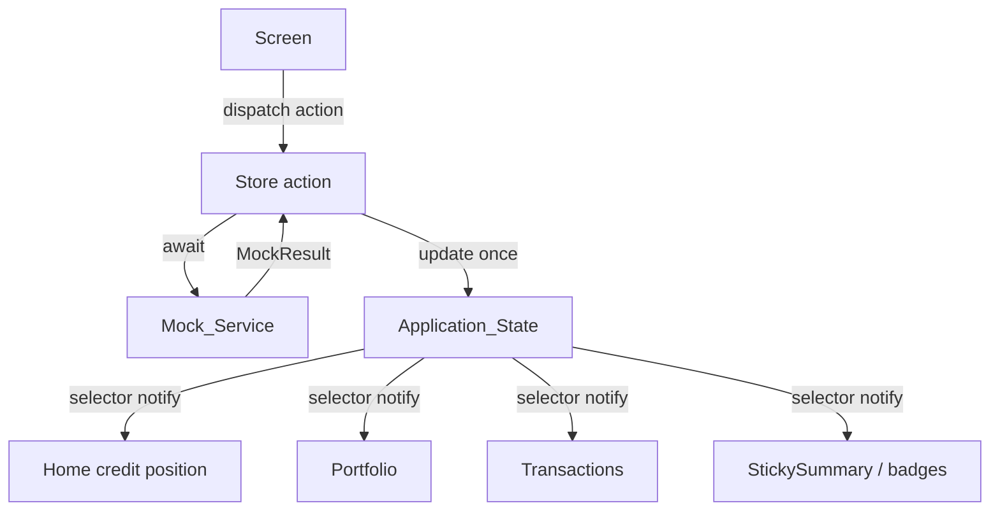
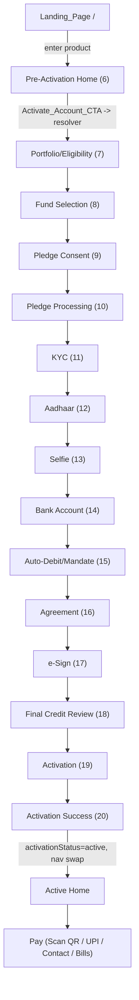

# Design Document

## Overview

LienPay is a premium, mobile-first fintech **prototype** delivered as a single web application composed of **two distinct experiences** built on **one shared design core**:

- **Experience A — Marketing/Landing_Page**: a public, cinematic marketing surface with inertial smooth scrolling, scroll reveals, parallax, animated financial numbers, pinned storytelling sections, and navbar transitions.
- **Experience B — Product_Application**: the product surface (Pre_Activation_Flow + Active_Account_Experience) using the **same visual identity** but **restrained, functional motion** and **native scrolling**.

Both experiences consume a single centralized **Design_System** (tokens + 23 reusable components), a single centralized **Application_State** store, a single centralized **Mock_Service**, and a single centralized **Animation_System**. No real banking/PAN/Aadhaar/UPI/mutual-fund/pledge/payment APIs are ever called — everything is simulated.

This design is derived strictly from `requirements.md`, which is the **source of truth**. Where the requirements contain internal inconsistencies (for example the fixed LTV of 34% or Used_Credit ₹0 versus the transaction/outstanding values), this document **flags** them in the *Conflicts & Ambiguities (Flagged)* section and proposes handling **without changing any requirement**. The requirement precedence order in Requirement 18 is respected throughout: the LienPay Application Design Specification and screenshots outrank this technical design, so where per-screen content is not yet supplied in text (Requirement 20.4), this design records a content-capture obligation rather than inventing content.

**Design goals**

- Preserve the fixed color tokens, typography, screen order, navigation rules, and character-for-character financial values.
- Keep marketing motion fully isolated (code-split) from the product bundle so the product app stays lightweight and 60fps-smooth on mobile.
- Make every cross-screen value flow from one reactive store so all dependent UI updates automatically.
- Keep the architecture buildable in the 12 defined implementation phases.

### Requirements Mapping (summary)

Each major section below lists the requirement numbers it satisfies. A consolidated table appears in the *Requirements Mapping* section at the end.

| Section | Primary Requirements |
| --- | --- |
| Two-Experience Architecture | 17, 3, 4, 16 |
| Technology Choices | 4, 16, 17, 19, 13 |
| State Model / Data Models | 19, 14, 12 |
| Navigation Architecture | 9, 10, 22 |
| Onboarding Resume Logic | 22, 5, 6, 7, 8, 13.5 |
| Component Architecture | 14, 3 |
| Mock Service Architecture | 13, 6, 7, 8, 21, 12 |
| Animation Architecture | 4, 16, 17 |
| Responsive Architecture | 15, 22.16 |
| Accessibility | 3.6, 3.7, 3.8, 15, 16.6, 4.8 |
| Financial State Updates | 21, 19.8, 11 |
| Initial Snapshot | 12, 19 |
| Typography / Font | 2 |
| Conflicts & Ambiguities | 18, 19.5, 20.4, 12 |
| Phase Boundaries | (structural, all requirements) |

## Architecture

### High-level architecture

The application is a client-only Single Page Application. The root splits immediately into two route trees that are **code-split at the entry/route level** but share the design core.



**Key architectural rules**

1. **Separation, not duplication.** The Landing motion runtime (smooth inertial scroll + scroll-trigger library) is dynamically imported **only** on the Landing route so it never ships in the Product_Application bundle (Req 17.5, 17.6, 4.14, 15). The Product_Application uses **native scrolling** and a small restrained-motion utility set (Req 16, 17.4, 17.6).
2. **Single sources of truth.** Design tokens, Application_State, mock data, navigation config, the Animation_System, and financial components are each defined **exactly once** (Req 14.2).
3. **Reactive propagation.** All cross-screen values live in Application_State; components subscribe via selectors so any change updates all dependents automatically (Req 14.4, 19.4, 19.8).
4. **Two navigation modes inside Experience B.** The Product_Application swaps between Pre_Activation_Nav (3 items) and Active_Account Bottom_Navigation (4 items) based on `activationStatus` (Req 9, 10, 22.14).

### Experience separation (code-splitting) detail



- Route-level `React.lazy` + `Suspense` boundaries create two independent chunks (`landing`, `app`).
- The heavy scroll/animation libraries are imported **inside** the landing chunk (and further guarded by a reduced-motion check) so they are never parsed by users who go straight to `/app`.
- Both chunks import the common chunk (tokens, components, store, mock), guaranteeing shared identity (Req 17.2, 3.2).

## Technology Choices

| Concern | Choice | Justification |
| --- | --- | --- |
| Framework | **React 18 + TypeScript** | Component reuse (23 shared components), strong typing for the state model and mock contracts, mature ecosystem for the required motion libraries. |
| Build tool | **Vite** | Fast dev server, first-class route-level code-splitting and dynamic `import()` for isolating the landing motion bundle (Req 4.14, 17.5). |
| Routing | **React Router v6** | Nested routes model the two experiences and the two in-app navigation modes cleanly; `lazy`/`Suspense` enables entry-level code-splitting. |
| State | **Zustand** | Minimal, centralized single store with fine-grained selector subscriptions so only dependent UI re-renders on change (Req 19.4, 14.4). No boilerplate, no context re-render storms, easy to keep as one source of truth. Session-scoped (in-memory) by default, which matches the reset-on-reload requirement (Req 5.9, 5.10, 11.12, 19.7). |
| Landing smooth scroll | **Lenis** (smooth-scroll library) | Purpose-built inertial smooth scrolling that settles quickly and drives scroll progress for triggers; scoped to Landing only (Req 4.1, 17.5). |
| Landing scroll animation | **GSAP + ScrollTrigger** | Robust, GPU-friendly transform/opacity animation with pinning/sticky support for storytelling sections, parallax, number count-up, and scrub — all durations/thresholds in Req 4 are directly expressible. |
| Product motion | **Framer Motion** (restrained subset) + small utility layer | Declarative screen transitions and value count-up within Req 16 durations; used sparingly. Native scrolling is preserved (Req 16, 17.4, 17.6). |
| Styling / tokens | **CSS Custom Properties (single `tokens.css`) + CSS Modules** | The 7 fixed colors and the type scale are declared once as CSS variables consumed by every component (Req 1.2, 2.4, 14.2). A build-time lint rule flags any hard-coded color outside the seven tokens (Req 1.3). |
| Fonts | **Self-hosted Satoshi via `@font-face`** | Bundled locally, no CDN (Req 2.7, 2.8). |
| Testing | **Vitest + React Testing Library + fast-check** | Vitest/RTL for unit and example tests; fast-check for property-based tests on the pure logic layer (resolver, financial reducers, formatting, snapshot reset). |

**Why not one bundle for everything?** The cinematic libraries (smooth scroll + scroll-trigger) are relatively heavy and only relevant to the Landing_Page. Keeping them in a landing-only chunk protects the Product_Application's mobile performance budget (Req 4.14, 15) and enforces the conceptual separation of Requirement 17.

## Folder Structure

```
src/
  main.tsx                     # bootstrap, router mount
  app-router.tsx               # entry-level split: / (landing) vs /app (product)

  design-system/               # SHARED CORE (imported by both experiences)
    tokens/
      tokens.css               # single source: 7 colors, spacing, radius
      typography.css           # single source: Satoshi scale (size/weight/line-height)
      tokens.ts                # typed token accessors (for JS-driven styles)
    fonts/
      satoshi/                 # locally bundled Satoshi assets (woff2) + @font-face
    components/                # the 23 Reusable_Components (one folder each)
      AppShell/ TopBar/ BottomNavigation/ PrimaryButton/ SecondaryButton/
      FinancialCard/ MetricCard/ StatusCard/ FundCard/ TransactionCard/
      RepaymentCard/ CreditHealthCard/ ProgressStepper/ ProcessTimeline/
      OTPInput/ InputField/ StickySummary/ BottomSheet/ Modal/
      SuccessState/ ErrorState/ LoadingState/ NotificationItem/
      index.ts                 # barrel export

  state/                       # SHARED CORE
    store.ts                   # single Zustand store (Application_State)
    selectors.ts               # memoized selectors
    initialSnapshot.ts         # canonical Initial_Snapshot (fixed values)
    reducers/
      financial.ts             # pay/repay pure reducers
      onboarding.ts            # status transitions
    resumeResolver.ts          # resume-step resolver (pure)

  mock/                        # SHARED CORE
    mockService.ts             # centralized Mock_Service interface + impl
    data/
      portfolio.ts transactions.ts repayments.ts funds.ts notifications.ts
    delay.ts                   # simulated delay helpers (500-2000 / 2000-5000)

  animation/                   # SHARED CORE (contracts + product utilities)
    contracts.ts               # durations, thresholds, reduced-motion helper
    product/                   # restrained reusable utilities (Framer Motion)
      screenTransition.ts valueCountUp.ts fadeSlide.ts microInteraction.ts

  formatting/
    inr.ts                     # Indian lakh grouping / per-value decimals

  navigation/
    routes.ts                  # route tables: landing (/), state-aware entry (/app),
                               #   pre-activation (/app/pre/*), active (/app/active/*)
    navConfig.ts               # bottom-nav (4) & pre-activation-nav (3) definitions
    guards.ts                  # exactly-four-tabs enforcement, activation swap (/app/pre -> /app/active)

  landing/                     # EXPERIENCE A (lazy chunk)
    LandingPage.tsx
    motion/                    # Lenis + GSAP runtime (dynamic import, landing-only)
    sections/                  # hero, storytelling (pinned), cards, numbers, navbar

  product/                     # EXPERIENCE B (lazy chunk)
    ProductApp.tsx             # state-aware /app entry: redirect by activationStatus
    pre-activation/            # /app/pre/* : 20 ordered screens + Home | Benefits | Learn
    active/                    # /app/active/* : Home, Transactions, Repayments, Portfolio, Profile, Notifications
      pay/                     # /app/active/pay/* : Scan QR, Enter UPI ID, Pay Contact, Bills, demo payment
```

## State Model

Application_State is a **single Zustand store**. It is **in-memory and session-scoped** — a page reload re-creates the store from the `Initial_Snapshot`, which satisfies "reset on reload" for both onboarding (Req 5.9, 5.10) and financial state (Req 11.12, 19.7). No persistence layer (no localStorage) is used for these values.

### Status enumerations

```ts
type StepStatus = "not_started" | "in_progress" | "complete";
type PledgeStatus = "not_started" | "processing" | "success" | "failed";
type ActivationStatus = "inactive" | "in_progress" | "active";
type CreditHealth = "Healthy"; // fixed display value (Req 12.1, 19.3)
```

### Full state shape

```ts
interface ApplicationState {
  // --- Onboarding / activation status fields (drive the resume resolver) ---
  onboardingStatus: {
    splash: StepStatus;
    mobileVerification: StepStatus;
    otpVerification: StepStatus;
    nameSetup: StepStatus;
    welcome: StepStatus;
    preActivationHome: StepStatus;
  };
  verificationStatus: {           // KYC block detail
    kyc: StepStatus;
    aadhaar: StepStatus;
    selfie: StepStatus;
  };
  portfolioStatus: StepStatus;    // eligibility screen reached/confirmed
  selectedFunds: string[];        // FundCard ids toggled on
  pledgeStatus: PledgeStatus;
  bankVerificationStatus: StepStatus;
  mandateStatus: StepStatus;
  agreementStatus: StepStatus;
  eSignStatus: StepStatus;
  finalReviewStatus: StepStatus;
  activationStatus: ActivationStatus;

  // --- Financial values (Initial_Snapshot on load) ---
  portfolioValue: string;         // "₹4,72,000" stored as display string (character-for-character)
  creditLimit: string;            // "₹2,21,500"
  availableCredit: string;        // "₹2,21,500"
  usedCredit: string;             // "₹0"
  ltv: string;                    // "34%" FIXED display value (NOT computed) - Req 19.3, 19.5
  creditHealth: CreditHealth;     // "Healthy" FIXED display value

  // Numeric mirrors used ONLY for pay/repay arithmetic (paise integers)
  creditLimitPaise: number;
  availableCreditPaise: number;
  usedCreditPaise: number;

  // --- Collections ---
  transactions: Transaction[];    // most-recent-first
  repayments: { outstanding: string; amountDue: string; history: Repayment[] };
  notifications: Notification[];

  // --- Session / preview ---
  session: {
    userName: string | null;
    currentScreenId: string;      // for progress indicator (1..20)
    previewMode: boolean;         // preview/session flag
    asyncInFlight: boolean;       // transient: a blocking mock operation is currently running
                                  // (drives Activate_Account_CTA disabled/in-flight guard; reset on reload)
  };
}
```

## Data Models

The collection and entity models held within Application_State and supplied by the Mock_Service.

### Collection models

```ts
interface Transaction {
  id: string;                 // stable id; demo payment gets a distinct id
  merchant: string;           // e.g. "DMart"
  amount: string;             // "₹1,856" character-for-character display string
  amountPaise: number;        // for arithmetic only
  origin: "seed" | "demo_payment"; // distinguishes seeded history from demo payment (double-count flag)
  timestamp: number;
}

interface Repayment { id: string; label: string; amount: string; timestamp: number; }
interface Notification { id: string; title: string; body: string; unread: boolean; }
interface Fund { id: string; name: string; value: string; eligible: boolean; }
```

**Design decisions**

- **Display strings are canonical.** Mandated financial values are stored as the exact display strings from the Mock_Service (Req 12.4). Arithmetic for pay/repay uses parallel integer paise fields so display fidelity is never lost to floating-point formatting. After a mutation the display string is re-derived via the Indian formatter (`formatting/inr.ts`).
- **LTV and Credit_Health are stored, never computed** (Req 19.3, 19.5). They are display constants; the internal inconsistency of LTV 34% is flagged, not resolved.
- **`origin` on transactions** exists specifically to keep the seeded DMart entry distinct from the demo-payment DMart entry so the two are never conflated (see *Conflicts & Ambiguities*).

### Store choice, selectors, and reactive propagation

- **Store choice:** Zustand — one store object, no providers required, selector-based subscriptions. This directly enables Req 14.4 / 19.4 / 19.8: a component subscribes to `useStore(s => s.availableCredit)` and re-renders only when that slice changes.
- **Selectors:** centralized in `state/selectors.ts` (e.g. `selectCreditPosition`, `selectTransactions`, `selectResumeStep`, `selectActiveNavMode`). Screens never read raw internal fields directly; they read through selectors so refactors stay local.
- **Propagation:** mutations are performed by store actions (`recordPayment`, `recordRepayment`, `completeStep`, `activateAccount`, `resetToSnapshot`). Each action updates the central state once; every subscribed selector recomputes; all dependent UI (Home credit position, Portfolio, Transactions, StickySummary, notifications badges) updates automatically without screen-to-screen wiring.

### Initial_Snapshot (canonical) and restore-on-reload

`state/initialSnapshot.ts` exports one frozen object — the single source for load-time values (Req 12, 19.2):

```ts
export const INITIAL_SNAPSHOT = Object.freeze({
  portfolioValue: "₹4,72,000",
  creditLimit:    "₹2,21,500",
  availableCredit:"₹2,21,500",
  usedCredit:     "₹0",
  ltv:            "34%",       // fixed display value (Req 19.3, 19.5) - NOT recalculated
  creditHealth:   "Healthy",
  creditLimitPaise:    22150000,
  availableCreditPaise:22150000,
  usedCreditPaise:            0,
  transactions: SEED_TRANSACTIONS, // 5 seeded entries, origin: "seed"
  repayments: { outstanding: "₹24,680", amountDue: "₹8,240", history: [] },
});
```

- **Restore-on-reload mechanism:** because the store is in-memory only, a browser reload naturally discards mutations and the store initializer re-reads `INITIAL_SNAPSHOT`. A `resetToSnapshot()` action is also provided for explicit resets and tests. This covers Req 5.10, 11.12, 19.7 without persistence.

## Navigation Architecture

The router has three levels: (1) entry-level experience split, (2) product navigation mode (pre-activation vs active), (3) per-screen routes. The two navigation modes are made **structurally explicit** in the route tree by segmenting the product experience under two path prefixes — `/app/pre/*` for the pre-activation experience and `/app/active/*` for the active-account experience — while `/app` itself is a **state-aware entry point** that redirects based on `activationStatus`. This route structure is an **implementation-architecture** device only: it does **not** change any product navigation labels, the exactly-3 / exactly-4 tab rules, the placement of Profile/Notifications in the Top_Bar, or any screen requirement.

### State-aware entry point (`/app`)

`/app` renders no screen of its own; it reads `activationStatus` from Application_State and redirects (Req 22.14, 10.8):

| `activationStatus` | Redirect target |
| --- | --- |
| `inactive` | `/app/pre/home` |
| `in_progress` | `/app/pre/home` (the Activate_Account_CTA resumes the flow via the resolver) |
| `active` | `/app/active/home` |



### Route table — Landing (Experience A)

| Path | Screen | Notes |
| --- | --- | --- |
| `/` | Landing_Page | lazy `landing` chunk; smooth inertial scroll + cinematic motion only here |

### Route table — Product Pre-Activation (Experience B, `activationStatus !== "active"`, `/app/pre/*`)

Bottom navigation shows **exactly three** items: Home, Benefits, Learn (Req 9.1).

| Path | Screen | Nav item (label) |
| --- | --- | --- |
| `/app/pre/home` | Pre-Activation Home (screen 6, hosts Activate_Account_CTA) | Home |
| `/app/pre/benefits` | Benefits | Benefits |
| `/app/pre/learn` | Learn | Learn |
| `/app/pre/onboarding/:step` | The 20 ordered Pre_Activation_Flow screens | (no nav item; flow context) |

The product navigation labels remain exactly **Home | Benefits | Learn** (Req 9.1); only the underlying paths are namespaced under `/app/pre`.

The 20-screen ordered flow (Req 5.1), fixed and never reordered/inserted/removed (Req 5.3, 7.7, 22.9):

`splash → mobile-verification → otp-verification → name-setup → welcome → pre-activation-home → portfolio-eligibility → fund-selection → pledge-consent → pledge-processing → kyc → aadhaar-verification → selfie-verification → bank-account → auto-debit-mandate → agreement → e-sign → final-credit-review → activation → activation-success`

### Route table — Product Active Account (Experience B, `activationStatus === "active"`, `/app/active/*`)

Bottom navigation shows **exactly four** items: Home, Transactions, Repayments, Portfolio (Req 10.1).

| Path | Screen | Nav item (label) |
| --- | --- | --- |
| `/app/active/home` | Active Home (credit position) | Home |
| `/app/active/transactions` | Transactions | Transactions |
| `/app/active/repayments` | Repayments | Repayments |
| `/app/active/portfolio` | Portfolio (+ Credit Limit Increase, Req 11.13) | Portfolio |
| `/app/active/profile` | Profile | **Top_Bar only** (Req 10.6, 10.9) |
| `/app/active/notifications` | Notifications | **Top_Bar only** (Req 10.6, 10.9) |
| `/app/active/pay/*` | Pay: Scan QR, Enter UPI ID, Pay Contact, Bills, demo payment | reachable from Home, **not** a nav tab (Req 21.2) |

The product navigation labels remain exactly **Home | Transactions | Repayments | Portfolio** (Req 10.1); only the underlying paths are namespaced under `/app/active`. **Profile and Notifications live only in the Top_Bar** and are reachable at `/app/active/profile` and `/app/active/notifications` but are **not** bottom-nav tabs (Req 10.2, 10.6, 10.9). **Pay (`/app/active/pay/*`), Learn, and Credit Limit Increase are never bottom-nav tabs** (Req 21.2, 11.13, 11.14); Pay remains reachable from the active Home screen.

### Enforcing exactly-N tabs

`navigation/navConfig.ts` declares the two nav sets as **fixed-length typed tuples**, and `navigation/guards.ts` validates them at module load:

```ts
const PRE_ACTIVATION_NAV = ["home", "benefits", "learn"] as const;          // length 3
const ACTIVE_NAV        = ["home", "transactions", "repayments", "portfolio"] as const; // length 4

function assertNav() {
  if (PRE_ACTIVATION_NAV.length !== 3) throw new Error("Pre-activation nav must be exactly 3 items");
  if (ACTIVE_NAV.length !== 4)        throw new Error("Active nav must be exactly 4 items");
  if (ACTIVE_NAV.includes("profile") || ACTIVE_NAV.includes("notifications"))
    throw new Error("Profile/Notifications must not be bottom-nav items");
  const forbidden = ["pay", "learn", "creditLimitIncrease", "activate"];
  if (ACTIVE_NAV.some(i => forbidden.includes(i))) throw new Error("Forbidden bottom-nav item");
}
```

The `BottomNavigation` component renders strictly from the active tuple and cannot be passed extra items. Active item styling uses a neon accent **plus** a non-color indicator (Req 10.4, 3.6).

### Active-account transition (nav swap)



When the Activation Success screen completes, `activateAccount()` sets `activationStatus = "active"`. A selector `selectActiveNavMode` reads `activationStatus` and the `AppShell` swaps `PRE_ACTIVATION_NAV` → `ACTIVE_NAV` and routes from the pre-activation experience (`/app/pre/*`) to the active experience at `/app/active/home` (Active Home). This is the single trigger for the nav swap (Req 10.8, 22.14, 22.15): the labels swap from **Home | Benefits | Learn** to **Home | Transactions | Repayments | Portfolio**, and the route prefix swaps from `/app/pre` to `/app/active`. The Activate_Account_CTA is hidden once active (Req 22.13).

## Onboarding Resume Logic

The **Activate_Account_CTA** on Pre-Activation Home is a **UI action, not a navigation item, tab, or new screen** (Req 22.6, 22.8). Pressing it invokes a pure **resume-step resolver** that maps Application_State status fields to the next incomplete step, then routes to that existing screen in the fixed 20-screen sequence. It never restarts completed screens (Req 22.10, 22.11) and never adds/reorders screens (Req 22.9). Resume is **intra-session only** — state is session-scoped and resets to Splash on reload (Req 5.9, 5.10).

### CTA call path



Normal path: from Pre-Activation Home (screen 6) with nothing yet done in eligibility, the resolver returns **Portfolio / Credit Eligibility (screen 7)** — the sequence continues, it does not restart (Req 22.10).

### Step-ordering table (resolver mapping)

| Order | Step id | Status field consulted |
| --- | --- | --- |
| 1 | splash | onboardingStatus.splash |
| 2 | mobile-verification | onboardingStatus.mobileVerification |
| 3 | otp-verification | onboardingStatus.otpVerification |
| 4 | name-setup | onboardingStatus.nameSetup |
| 5 | welcome | onboardingStatus.welcome |
| 6 | pre-activation-home | onboardingStatus.preActivationHome |
| 7 | portfolio-eligibility | portfolioStatus |
| 8 | fund-selection | selectedFunds (>=1 ⇒ complete) |
| 9 | pledge-consent | pledgeStatus (success/processing ⇒ past) |
| 10 | pledge-processing | pledgeStatus === "success" |
| 11 | kyc | verificationStatus.kyc |
| 12 | aadhaar-verification | verificationStatus.aadhaar |
| 13 | selfie-verification | verificationStatus.selfie |
| 14 | bank-account | bankVerificationStatus |
| 15 | auto-debit-mandate | mandateStatus |
| 16 | agreement | agreementStatus |
| 17 | e-sign | eSignStatus |
| 18 | final-credit-review | finalReviewStatus |
| 19 | activation | activationStatus === "active" ⇒ past |
| 20 | activation-success | activationStatus === "active" |

### Resolver pseudocode (pure function)

```ts
// resolveResumeStep: Application_State -> stepId (the first incomplete step)
function resolveResumeStep(state): StepId {
  const ordered: Array<[StepId, () => boolean]> = [
    ["splash",                () => isComplete(state.onboardingStatus.splash)],
    ["mobile-verification",   () => isComplete(state.onboardingStatus.mobileVerification)],
    ["otp-verification",      () => isComplete(state.onboardingStatus.otpVerification)],
    ["name-setup",            () => isComplete(state.onboardingStatus.nameSetup)],
    ["welcome",               () => isComplete(state.onboardingStatus.welcome)],
    ["pre-activation-home",   () => isComplete(state.onboardingStatus.preActivationHome)],
    ["portfolio-eligibility", () => isComplete(state.portfolioStatus)],
    ["fund-selection",        () => state.selectedFunds.length >= 1],
    ["pledge-consent",        () => state.pledgeStatus !== "not_started"],
    ["pledge-processing",     () => state.pledgeStatus === "success"],
    ["kyc",                   () => isComplete(state.verificationStatus.kyc)],
    ["aadhaar-verification",  () => isComplete(state.verificationStatus.aadhaar)],
    ["selfie-verification",   () => isComplete(state.verificationStatus.selfie)],
    ["bank-account",          () => isComplete(state.bankVerificationStatus)],
    ["auto-debit-mandate",    () => isComplete(state.mandateStatus)],
    ["agreement",             () => isComplete(state.agreementStatus)],
    ["e-sign",                () => isComplete(state.eSignStatus)],
    ["final-credit-review",   () => isComplete(state.finalReviewStatus)],
    ["activation",            () => state.activationStatus === "active"],
    ["activation-success",    () => state.activationStatus === "active"],
  ];

  // Return the FIRST step whose completion predicate is false.
  for (const [stepId, done] of ordered) {
    if (!done()) return stepId;
  }
  return "activation-success"; // all complete
}
```

Because the resolver returns the **first incomplete** step in the fixed order, completed steps are skipped and never restarted (Req 22.10). If no step is complete, it returns the flow's natural start after Home (Req 22.8). Existing state is preserved on continuation — the resolver is read-only (Req 22.11).

### Resolver is READ-ONLY (reaffirmed)

`resolveResumeStep` is a **pure, side-effect-free** function. It reads the Application_State status fields and returns a `stepId`; it performs **no mutations**, records **no status transitions**, and **triggers no mock operations** (no OTP send/verify, no Pledge Processing, no KYC/Aadhaar/Selfie, no Bank/Mandate/e-Sign/Final Review/Activation). Resuming therefore never advances a step by itself and never re-runs a completed step — it only computes *where to route* (Req 22.10, 22.11). All actual step execution happens on the destination screen when the user acts there.

### Activate_Account_CTA async safety (guard against duplicate/concurrent operations)

The Activate_Account_CTA must never kick off a duplicate or concurrent mock operation. Two independent guards enforce this (Req 22, 6, 7, 8, 13.5):

1. **Disabled while a blocking async operation is in progress.** Whenever any blocking activation/verification mock operation is currently running, the CTA is rendered in a **disabled** state and cannot be pressed. The blocking operations are: **OTP verification, Pledge Processing, KYC, Aadhaar, Selfie, Bank Verification, Mandate, e-Sign, Final Review, and Activation.** While disabled, the CTA still follows the Design_System (Req 22.3/22.4) but does not accept presses.

2. **In-flight guard against duplicate/concurrent invocations.** Even outside those steps, the CTA carries a transient **in-flight flag**. On press it (a) checks the flag, (b) if already in-flight it ignores the press (no-op), otherwise (c) sets the flag, runs the read-only resolver + navigation, then clears the flag. This makes the press **idempotent** for the duration of the action, so a rapid double-tap or concurrent trigger can never launch two operations or two navigations.

#### Representing "in progress"

"In progress" is represented as a **transient, session-scoped async status** held in the preview/session portion of Application_State — it is not a new product concept and changes no product requirement. Concretely:

- The existing status enums already express a running blocking step: `pledgeStatus === "processing"` (Pledge Processing) and, for the 500–2000ms simulated steps (Req 8.1/8.2/8.4, 6.2/6.3), the destination screen holds the step `StepStatus` at `"in_progress"` while the Mock_Service call is pending. The same `LoadingState` that Req 13.5 mandates is shown during this window.
- A small transient field in `session` — an **`asyncInFlight`** boolean (in-memory, reset on reload like the rest of the session state) — represents "a blocking mock operation is currently running" and is the single value the CTA's disabled/in-flight guard reads. It is derived/set purely from the async lifecycle (set when a blocking operation starts, cleared when it resolves or errors); it is **not** persisted and carries no product-facing meaning.

A selector `selectActivateCtaDisabled` combines these signals — the CTA is disabled when `session.asyncInFlight` is true or when any of the blocking steps (`otpVerification`, `pledgeStatus === "processing"`, `kyc`, `aadhaar`, `selfie`, `bankVerification`, `mandate`, `eSign`, `finalReview`, `activation`) is `in_progress` — and when `activationStatus === "active"` the CTA is hidden entirely (Req 22.13). None of this alters the fixed 20-screen sequence, labels, or any screen requirement.

> **Implementation Rule (Activate_Account_CTA async safety):**
>
> - The Activate_Account_CTA MUST be disabled while ANY blocking Mock_Service operation is in progress.
> - Blocking operations include: OTP verification, Pledge Processing, KYC, Aadhaar verification, Selfie verification, Bank verification, Mandate, e-Sign, Final Review, and Activation.
> - The CTA MUST never initiate or duplicate a Mock_Service operation.
> - The resume resolver remains read-only (no mutations, no status transitions, triggers no Mock_Service operations; it only resolves the next incomplete screen).
>
> This rule is the authoritative restatement of the async-safety subsection above; it is enforced by the `selectActivateCtaDisabled` selector and the transient `session.asyncInFlight` flag. **Validates: Requirements 22, 6, 7, 8, 13.5**

## Components and Interfaces

*(Component Architecture.)* The Design_System provides **exactly the 23 Reusable_Components** named in Req 14.1, each defined once and shared by both experiences. Screens compose these components; **no screen-specific duplicates** are permitted (Req 14.3, 14.6).

### Component hierarchy

```mermaid
graph TD
    AppShell --> TopBar
    AppShell --> BottomNavigation
    AppShell --> ScreenOutlet["(routed screen)"]

    TopBar --> ProfileCtl["Profile control (icon+label)"]
    TopBar --> NotifCtl["Notifications control (icon+label)"]

    ScreenOutlet --> FinancialCard
    ScreenOutlet --> MetricCard
    ScreenOutlet --> StatusCard
    ScreenOutlet --> CreditHealthCard
    ScreenOutlet --> FundCard
    ScreenOutlet --> TransactionCard
    ScreenOutlet --> RepaymentCard
    ScreenOutlet --> ProgressStepper
    ScreenOutlet --> ProcessTimeline
    ScreenOutlet --> OTPInput
    ScreenOutlet --> InputField
    ScreenOutlet --> StickySummary
    ScreenOutlet --> NotificationItem

    subgraph Primitives / feedback (overlay layer)
        PrimaryButton
        SecondaryButton
        BottomSheet
        Modal
        SuccessState
        ErrorState
        LoadingState
    end
```

### Component → screen mapping

| Component | Primary screens |
| --- | --- |
| AppShell | all Product_Application screens (frame: TopBar + content + BottomNavigation) |
| TopBar | all active + pre-activation product screens (hosts Profile, Notifications) |
| BottomNavigation | pre-activation (3 items) and active (4 items) modes |
| PrimaryButton | Activate_Account_CTA, all primary CTAs, Pay confirm, Repay |
| SecondaryButton | back / secondary actions across flow |
| FinancialCard | Home credit position, Portfolio value blocks, eligibility |
| MetricCard | Credit_Limit / Available / Used / LTV metrics |
| StatusCard | verification/pledge/mandate status displays |
| FundCard | Fund Selection (max 50), Portfolio fund holdings |
| TransactionCard | Transactions list, Home recent activity |
| RepaymentCard | Repayments history |
| CreditHealthCard | Home + Portfolio Credit_Health |
| ProgressStepper | Pre_Activation_Flow position indicator (1..20, Req 5.4) |
| ProcessTimeline | Pledge Processing, Activation multi-step progress |
| OTPInput | OTP Verification |
| InputField | Mobile, Name, Bank Account, UPI ID |
| StickySummary | Fund Selection / Pledge / Review summaries |
| BottomSheet | Pay actions (Scan QR, UPI ID, Contact, Bills), confirmations |
| Modal | confirmations, agreement, errors |
| SuccessState | Activation Success, payment success |
| ErrorState | validation + mock failure states |
| LoadingState | all simulated async operations (Req 13.5) |
| NotificationItem | Notifications screen |

All components consume tokens via CSS variables, so a token change propagates to every component automatically (Req 14.5), and the same component renders identically on every screen (Req 14.6).

## Mock Service Architecture

A single centralized `Mock_Service` is the **only** data/action layer. It **never** calls real banking/PAN/Aadhaar/UPI/mutual-fund/pledge/payment endpoints and issues **no outbound network requests** (Req 13.1, 13.2). All demo data comes from one central dataset (Req 12.5).

### Service interface

```ts
interface MockResult<T> { status: "success" | "error"; data?: T; error?: string; }

interface MockService {
  // Data reads (from central dataset)
  getPortfolioSnapshot(): Promise<MockResult<Snapshot>>;
  getFunds(): Promise<MockResult<Fund[]>>;          // max 50 (Req 7.2)
  getTransactions(): Promise<MockResult<Transaction[]>>;
  getRepayments(): Promise<MockResult<RepaymentData>>;
  getNotifications(): Promise<MockResult<Notification[]>>;

  // Simulated verification / setup (500-2000ms) - Req 6, 8
  sendOtp(mobile: string): Promise<MockResult<void>>;
  verifyOtp(code: string): Promise<MockResult<void>>;
  submitKyc(payload): Promise<MockResult<void>>;
  submitAadhaar(payload): Promise<MockResult<void>>;
  submitSelfie(payload): Promise<MockResult<void>>;
  captureBankAccount(payload): Promise<MockResult<void>>;
  setupMandate(payload): Promise<MockResult<void>>;

  // Deliberately long-running (2000-5000ms) - Req 7.6
  processPledge(funds: string[]): Promise<MockResult<void>>;

  // State-changing simulated operations - Req 21, 11
  makeDemoPayment(): Promise<MockResult<Transaction>>; // DMart ₹1,856
  makeRepayment(amount): Promise<MockResult<void>>;
}
```

### Delay strategy

- **Standard simulated delay:** 500–2000ms for verification, OTP, bank, mandate, generic async (Req 6.2/6.3, 8.1/8.2/8.4, 13.3).
- **Deliberate long-running:** 2000–5000ms only where required, specifically **Pledge Processing** (Req 7.6).
- The UI shows a `LoadingState` for the duration and until a result returns or the max delay elapses (Req 13.5).

### Success / failure / loading / unknown-request behavior

- Each method can resolve **success** or **error**; failure paths drive `ErrorState` while preserving existing screen data (Req 7.8, 8.3, 11.8, 13.4).
- If the service receives a request with no matching mock data, it returns a mock error and leaves screen data unchanged (Req 13.4).
- If demo data cannot load, screens show an unavailable indication and **never** render placeholder/blank/partial financial values (Req 12.6).

### How screens consume it

Screens call the Mock_Service through store actions (never directly wiring UI to raw promises). A typical flow: screen dispatches action → action shows `LoadingState` → awaits Mock_Service → on success updates Application_State centrally → all dependents re-render (Req 19.8). State-changing operations (`makeDemoPayment`, `makeRepayment`, `processPledge`) update the store; read operations hydrate collections.

## Animation Architecture

The Animation_System is centralized as **contracts** (durations, thresholds, reduced-motion) plus two implementation layers: a **Landing (cinematic) runtime** and **Product (restrained) utilities**. Both read the same duration/threshold contracts and the same reduced-motion helper so behavior is consistent (Req 16.1) and reduced-motion is honored everywhere (Req 4.8, 16.6).

### Reduced-motion gate (shared)

```ts
const prefersReducedMotion = () =>
  window.matchMedia("(prefers-reduced-motion: reduce)").matches;
```

When enabled: Landing disables reveals, parallax, number animations, text reveals, card entrances, glow transitions, and pinned motion, presenting final states immediately (Req 4.8); Product disables scroll reveals, section transitions, and value-change animations, showing final states immediately (Req 16.6).

### Landing motion architecture (Experience A only)

Implemented with **Lenis (smooth inertial scroll) + GSAP/ScrollTrigger**, dynamically imported in the landing chunk only. Smooth inertial scrolling applies **only** to the Landing_Page (Req 4.1, 17.5); the Product_Application uses native scroll (Req 17.6).

| Effect | Implementation | Quantified rule (Req 4) |
| --- | --- | --- |
| Smooth inertial scrolling | Lenis | settles 0.8–1.2s, ≥60fps (4.1) |
| Section scroll reveal | ScrollTrigger + opacity/transform | trigger at ≥10% visible; opacity 0→1, translate 16–32px→0 over 400–800ms (4.2) |
| Text reveal | transform + opacity | at ≥10% visible (4.9) |
| Parallax | ScrollTrigger scrub, transform | max offset 60px; reduced/disabled <768px (4.3, 4.14) |
| Animated financial numbers | GSAP tween of value | at ≥10% visible; to exact final value over 1000–2000ms (4.4) |
| Card entrance | transform + opacity | at ≥10% visible (4.10) |
| Navbar transition | ScrollTrigger state | smooth navbar transition on scroll (4.12) |
| Sticky/pinned storytelling | ScrollTrigger pin | pin designated sections (4.13) |
| Green-glow transition | opacity/box-shadow within glow limits | ≤3 glow elements/screen (4.11, Req 1.6) |
| Button micro-interaction | transform scale | begin ≤100ms, scale 0.95–1.05 (4.5) |
| Excluded effects | — | no bounce/elastic/spring-back/cartoon (4.6) |

All landing motion uses **transform/opacity only**, targets ≥60fps, and reduces/disables parallax + glow below 768px (Req 4.14).

### Product motion utilities (Experience B)

Native scrolling + **reusable** restrained utilities (Framer Motion), defined once and applied consistently — **not** re-authored per screen (Req 16.1, 17.4):

| Utility | Behavior | Quantified rule (Req 16) |
| --- | --- | --- |
| `screenTransition` | fade/slide between screens | 200–400ms (16.2) |
| `valueCountUp` | animate financial value change from old→new | 300–800ms (16.3) |
| `fadeSlide` | element enter/exit | ease-based only |
| `microInteraction` | button press/hover feedback | 100–250ms (16.4) |

Timing is linear/ease-based only; overshoot, bounce, elastic, spring-back, rotation, and scale-pulse are excluded (Req 16.5).

## Responsive Architecture

Mobile-first. A single set of breakpoints drives both experiences, with different layout strategies per experience (Req 15).

| Breakpoint | Range | Landing_Page | Product_Application |
| --- | --- | --- | --- |
| xs | <390px | fluid full-width sections | fluid phone column, no clip/scroll, 44px targets (15.5) |
| base | 390 / 393 / 430px | full-width sections | phone-like column; no horizontal scroll, no clipping, 44px targets (15.1) |
| md | 768px | full-width; reduce/disable parallax+glow | centered phone shell (15.2, 4.14) |
| lg | 1024px | full-width sections, **content capped at 1280px**, centered (15.3) | **centered phone-like shell**, not stretched (15.4) |
| xl | up to 2560px | capped 1280px, centered | centered phone shell (15.2) |

**Strategy**

- **Product_Application** renders inside a max-width phone column (a centered shell) at all widths ≥768px, so the mobile UI is never stretched to desktop width (Req 15.4).
- **Landing_Page** uses full-width responsive sections with content constrained to a **1280px** centered max-width at ≥1024px (Req 15.3).
- Layouts use fluid units and flexbox/grid so widths below 390px adapt without horizontal scroll or clipping and preserve readable type and 44px touch targets (Req 15.5).
- The Activate_Account_CTA is validated at 390/393/430/768/1024px+: fully visible, above the mobile safe area, never overlapping the Bottom_Navigation or fixed elements (Req 22.16, 22.2).

## Accessibility

- **Keyboard focus:** every interactive control shows a visible focus indicator (Req 3.7).
- **Accessible labels:** every icon-only control (including Top_Bar Profile and Notifications) has an accessible text label (Req 3.8).
- **Touch targets:** minimum 44×44px for all interactive targets across all breakpoints (Req 15.1, 15.5, 22.4).
- **Reduced motion:** honored across both experiences via the shared gate (Req 4.8, 16.6).
- **Contrast:** body text ≥4.5:1, large text ≥3:1 against near-black surfaces (Req 3.1).
- **Non-color indicators:** active/selected states use a secondary non-color indicator (underline/marker/weight) in addition to the neon accent, so state is never signaled by color alone (Req 3.6, 10.4).

## Data Flow



A value updated once in Application_State reactively updates every dependent screen/element (Req 14.4, 19.4, 19.8, 11.11).

## Screen Flow



## Financial State Updates

After simulated **payment** and **repayment** operations, financial values update centrally and all dependent UI reacts (Req 21.4, 19.8, 11.10, 11.11).

### Payment reducer (pure, paise arithmetic)

```
recordPayment(state, amountPaise):
  usedCreditPaise      = state.usedCreditPaise + amountPaise
  availableCreditPaise = state.creditLimitPaise - usedCreditPaise
  usedCredit           = formatINR(usedCreditPaise)
  availableCredit      = formatINR(availableCreditPaise)
  transactions         = [ newTxn, ...state.transactions ]   // most-recent-first
  # creditLimit, ltv, creditHealth are NOT recomputed (fixed display values)
```

Invariant preserved: `availableCreditPaise + usedCreditPaise == creditLimitPaise`.

### Repayment reducer

```
recordRepayment(state, amountPaise):
  usedCreditPaise      = max(0, state.usedCreditPaise - amountPaise)
  availableCreditPaise = state.creditLimitPaise - usedCreditPaise
  # outstanding/amountDue display strings updated from repayment mock data
```

### DMart demo payment (₹1,856) — relationship to the seeded DMart transaction

The seeded dataset already contains a **DMart ₹1,856** transaction (Req 12.2), and the Pay flow defines a **demo payment** with Merchant "DMart", Amount ₹1,856 (Req 21.3). This is a **flagged ambiguity** (see *Conflicts & Ambiguities*). To avoid double counting while honoring both requirements verbatim:

- The seeded 5 transactions are **display-only history** and, consistent with the Initial_Snapshot `Used_Credit ₹0` (Req 12.1), **do not contribute to `usedCreditPaise`**. They are marked `origin: "seed"`.
- The demo payment, when completed, appends a **new, distinct transaction** with `origin: "demo_payment"` and its own id/timestamp, and **it** is what moves `usedCreditPaise` from 0 → ₹1,856 and reduces `availableCreditPaise` accordingly (Req 21.4, 11.10).
- Because the demo-payment entry is distinct (`origin`, id, timestamp) from the seeded entry, the two DMart rows are never merged or mistaken for one another, and the spend is counted exactly once.

Recommended handling is presented as design guidance only; the requirement values are not altered.

## Correctness Properties

*A property is a characteristic or behavior that should hold true across all valid executions of a system — essentially, a formal statement about what the system should do. Properties serve as the bridge between human-readable specifications and machine-verifiable correctness guarantees.*

These properties apply to LienPay's **pure logic layer**: the resume-step resolver, the credit/financial reducers, the Indian currency formatter, the snapshot-reset logic, and the input validators. UI rendering, motion timing, visual language, responsive layout, and font loading are **not** property-tested (they are covered by example/snapshot/manual QA per the Testing Strategy).

### Property 1: Resume resolver returns the first incomplete step

*For any* Application_State, the resume-step resolver returns the first step in the fixed 20-step order whose completion predicate is false, and every step preceding the returned step is complete (no completed step is ever restarted). If no activation step is complete, it returns the first pending onboarding step rather than any newly created screen.

**Validates: Requirements 22.10, 22.8, 22.11**

### Property 2: Fixed 20-screen order is invariant

*For any* Application_State, the ordered list of step ids produced by the resolver equals the mandated 20-screen sequence exactly (same items, same order, length 20) — no screen is added, removed, reordered, or inserted.

**Validates: Requirements 5.1, 5.3, 7.7, 22.9**

### Property 3: Indian currency formatting round-trip and grouping

*For any* non-negative integer paise amount, formatting it produces a rupee string using Indian lakh digit grouping with the value's own decimal formatting, and parsing that formatted string returns the original amount (round-trip identity).

**Validates: Requirements 12.4, 7.1, 21.6**

### Property 4: Credit position invariant across any pay/repay sequence

*For any* Initial_Snapshot and *any* finite sequence of simulated payment and repayment operations with amounts within the credit limit, after applying the sequence the equality `availableCreditPaise + usedCreditPaise == creditLimitPaise` holds, `usedCreditPaise` never becomes negative, and the displayed `availableCredit`/`usedCredit` strings equal the Indian-formatted values of the respective paise fields.

**Validates: Requirements 21.4, 11.10, 19.8**

### Property 5: Demo payment appends a distinct transaction counted exactly once

*For any* Initial_Snapshot, completing the DMart ₹1,856 demo payment prepends exactly one new transaction with `origin: "demo_payment"` and a distinct id (never merging with the seeded DMart entry), increases the transaction count by exactly one, and increases `usedCreditPaise` by exactly the demo-payment amount (single, non-duplicated count).

**Validates: Requirements 21.3, 21.4, 12.2**

### Property 6: Reset-to-snapshot is canonical and idempotent

*For any* mutated Application_State, applying `resetToSnapshot` yields a state whose mandated values deep-equal the canonical `INITIAL_SNAPSHOT`, and applying `resetToSnapshot` twice produces the same result as applying it once (idempotence).

**Validates: Requirements 19.7, 11.12, 5.10, 19.2**

### Property 7: LTV and Credit_Health are fixed display values

*For any* sequence of pay/repay/pledge/credit-change operations, the `ltv` value remains the string `"34%"` and `creditHealth` remains `"Healthy"` — neither is ever recomputed from other state values.

**Validates: Requirements 19.3, 19.5**

### Property 8: Input validators reject empty, whitespace-only, and malformed input

*For any* string that is empty or composed entirely of whitespace (and, for typed fields, *any* string violating the field's format such as a mobile number outside 10–15 digits or an OTP not exactly 6 digits), the corresponding validator rejects the input; *for any* well-formed value within the defined bounds, the validator accepts it.

**Validates: Requirements 6.5, 6.6, 8.3, 5.5**

## Error Handling

| Condition | Handling | Requirement |
| --- | --- | --- |
| Invalid/empty required input on a flow screen | Remain on screen, retain values, show `ErrorState`/field error identifying the problem | 5.5, 6.5, 6.6, 8.3 |
| Mock verification/mandate/bank failure | Show `ErrorState`, preserve entered data, allow retry | 8.x |
| Pledge processing failure | Remain on Pledge Processing, show error, preserve selected funds | 7.8 |
| Pledge consent without consent or zero funds | Remain on screen, message requiring consent + ≥1 fund | 7.5 |
| e-Sign not completed | Prevent advancement, show e-Sign-required error | 8.6 |
| Navigation fails within time budget | Retain current screen, keep prior active item, show navigation error | 9.4, 10.5 |
| Demo/mock data fails to load | Show "data unavailable" indication; never render placeholder/blank/partial financial values | 11.8, 12.6 |
| Mock_Service request with no matching data | Return mock error, leave existing screen data unchanged | 13.4 |
| Unresolved design token | Fall back to default token, record condition, preserve dark high-contrast presentation | 3.5 |
| Satoshi font load failure within 3s | Render fallback sans-serif preserving scale/weight/layout | 2.2 |
| Activate_Account_CTA pressed while a blocking async op is in progress | CTA is disabled (OTP verify, Pledge Processing, KYC, Aadhaar, Selfie, Bank Verification, Mandate, e-Sign, Final Review, Activation); press is a no-op, no duplicate operation is triggered | 22, 6, 7, 8, 13.5 |
| Rapid double-tap / concurrent Activate_Account_CTA invocation | Transient in-flight flag makes the press idempotent; the second invocation is ignored until the first resolves | 22, 13.5 |

## Testing Strategy

**Dual approach.**

- **Property-based tests (fast-check, ≥100 iterations each):** implement Properties 1–8 above, one property-based test per property. Each test is tagged:
  `// Feature: lienpay, Property {number}: {property_text}`
  These cover the pure logic layer (resolver, reducers, formatter, snapshot reset, validators). A property-based testing library is used — property logic is never hand-rolled.
- **Example-based unit tests (Vitest + RTL):** specific screen behaviors, the nav guards (exactly 3 / exactly 4 items; Profile/Notifications excluded), the `/app` state-aware redirect (`inactive`/`in_progress` → `/app/pre/home`, `active` → `/app/active/home`), the activation nav-swap (`/app/pre/*` → `/app/active/*`), the Activate_Account_CTA call path, the CTA async-safety guard (disabled while a blocking op is in progress; in-flight flag prevents duplicate/concurrent invocation), empty-states, and error-states.
- **Snapshot / visual tests:** the 23 reusable components and Landing sections (motion presentation and visual language are validated by snapshot + manual review, not PBT).
- **Integration/smoke tests (1–3 examples):** Mock_Service delay bounds (500–2000ms standard; 2000–5000ms for Pledge Processing), and verification that **no outbound network request** is issued (assert `fetch`/`XMLHttpRequest` are never called with external endpoints) — Req 13.1/13.2.
- **Accessibility checks:** automated contrast/label/focus assertions plus manual reduced-motion and keyboard passes.

**Why PBT is scoped to logic only:** the marketing/motion, visual language, responsive layout, and font-loading requirements are rendering/environment concerns whose behavior does not vary meaningfully with generated inputs; they use snapshot/example/manual testing instead.

## Conflicts & Ambiguities (Flagged)

Per Requirement 18, conflicts are surfaced, never silently resolved. The following are flagged with recommended **design-level** handling that does **not** change any requirement.

1. **LTV 34% is not derivable (Req 19.5).** With Used_Credit ₹0, Portfolio Value ₹4,72,000, and Credit_Limit ₹2,21,500, an LTV of 34% cannot be computed. **Handling:** store LTV as a fixed display string `"34%"`; never recompute it (Req 19.3). Flagged in state model and Property 7.

2. **Fixed values are not internally reconcilable.** Used_Credit ₹0 (Req 12.1) coexists with five seeded transactions (~₹12,197.50 total, Req 12.2) and an Outstanding of ₹24,680 (Req 12.3). **Handling:** treat the seeded transactions and repayment figures as **display-only history** that do not feed `usedCreditPaise`; the Initial_Snapshot Used_Credit remains ₹0 exactly as mandated. Only simulated in-session operations move Used/Available. Flagged; values unchanged.

3. **DMart demo payment vs seeded DMart entry (Req 21.3 vs 12.2).** Both are DMart ₹1,856. **Handling:** the demo payment appends a **distinct** transaction (`origin: "demo_payment"`, own id/timestamp) so it is never conflated with the seeded entry (`origin: "seed"`), preventing double counting. Verified by Property 5.

4. **Post-activation reload behavior.** Reqs 5.10 (reset to Splash during onboarding) and 11.12/19.7 (reset to Initial_Snapshot) both apply to a session-scoped store, so any reload returns to the initial, inactive state — including after activation. **Handling:** state is in-memory/session-scoped with no persistence; a reload re-initializes from `INITIAL_SNAPSHOT` (activationStatus back to "inactive"). This is the literal consequence of the session-scoped requirements; flagged so stakeholders confirm this is intended for the prototype rather than persisting activation.

5. **Missing per-screen content source-spec artifact (Req 20.4).** The LienPay Application Design Specification is the primary source for per-screen content (Req 20.1–20.3) and outranks this technical design (Req 18.1), but the detailed text content is not yet supplied. **Handling:** this design defines structure, components, state, and behavior only; it records a **content-capture obligation** — each screen's exact copy, labels, fields, and states must be captured from the Design Specification/screenshots before that screen is implemented (Req 20.4). No screen content is invented here.

   **Screen content source of truth (explicit).** BEFORE implementing any individual screen, the implementation MUST use the **LienPay Application Design Specification / screenshots** as the source of truth for that screen's exact: **copy, labels, fields, buttons, cards, states, values, and screen-specific visual structure** (Req 20.1, 20.2, 18.1). The implementation MUST NOT invent missing screen content: where the Design Specification/screenshots do not yet supply a screen's content in text form, that content MUST first be captured from the Design Specification/screenshots (Req 20.4) rather than authored ad hoc. This technical design intentionally specifies only architecture, components, state, navigation paths, and behavior; it defers all per-screen content — including the exact values, labels, and visual structure of each screen — to the higher-precedence Design Specification/screenshots (Req 18.1, 18.2, 20.3).

## Phase Boundaries

The architecture is organized so implementation can proceed in **12 phases**, each with a clear boundary and deliverable. (This section defines boundaries only — it does **not** generate implementation tasks.)

| Phase | Scope | Deliverable / boundary |
| --- | --- | --- |
| 1 | Foundation + Design System + Motion | Vite/React/TS scaffold, `tokens.css` (7 colors) + typography, self-hosted Satoshi `@font-face`, the 23 reusable components, Zustand store skeleton + Initial_Snapshot, Mock_Service interface, animation contracts + reduced-motion gate, entry-level route split. Boundary: shared core compiles and components render in isolation. |
| 2 | Landing | Landing_Page with Lenis + GSAP/ScrollTrigger (lazy chunk): inertial scroll, reveals, parallax, animated numbers, pinned sections, navbar transition, glow limits. Boundary: landing motion isolated from app bundle, reduced-motion honored. |
| 3 | Pre-Activation shell | Pre_Activation_Nav (Home/Benefits/Learn), Pre-Activation Home (screen 6) + Activate_Account_CTA + resume resolver wiring. Boundary: CTA routes via resolver to the correct existing screen. |
| 4 | Eligibility + Fund Selection + Pledge | Screens 7–10, FundCard toggles, StickySummary, Pledge Processing long-running (2–5s). Boundary: pledge success advances to KYC without reordering. |
| 5 | KYC + Bank + Mandate + Agreement + e-Sign | Screens 11–17 with mock verification (500–2000ms), validation/error states. Boundary: e-Sign completion advances to Final Review. |
| 6 | Activation | Screens 18–20 (Final Credit Review, Activation, Activation Success), `activateAccount()` sets activationStatus="active". Boundary: nav swap trigger fires. |
| 7 | Active Home | Active_Account Bottom_Navigation (4 tabs), Home credit position via selectors. Boundary: 4-tab nav enforced; Profile/Notifications in Top_Bar only. |
| 8 | Transactions + Payment | Transactions list (recent-first), Pay experience (Scan QR/UPI/Contact/Bills) + DMart demo payment updating central state. Boundary: payment updates propagate to all dependents; single count. |
| 9 | Repayments | Repayments screen (Outstanding, Amount Due, history), repayment reducer. Boundary: repayment updates propagate. |
| 10 | Portfolio + Credit Limit Increase | Portfolio screen with pledged investments, fund holdings, Credit Limit Increase (in-screen, not a tab). Boundary: no fifth tab. |
| 11 | Learn + Profile + Notifications | Learn (reachable, not a tab), Profile + Notifications (Top_Bar), NotificationItem list, empty/error states. Boundary: access points correct. |
| 12 | Responsive QA + Motion Polish + UX QA | Breakpoint validation (390/393/430/768/1024/2560), Activate_Account_CTA responsive checks, motion polish, accessibility + reduced-motion passes. Boundary: all responsive/accessibility/motion requirements verified. |

## Requirements Mapping

| Requirement | Addressed in |
| --- | --- |
| 1 (Color tokens) | Technology Choices, Design System / Folder Structure, Accessibility |
| 2 (Typography / Satoshi) | Technology Choices, Folder Structure (fonts), Error Handling |
| 3 (Visual language) | Two-Experience Architecture, Component Architecture, Accessibility |
| 4 (Landing motion) | Animation Architecture (Landing) |
| 5 (Pre-activation order) | Navigation Architecture, Onboarding Resume Logic, Properties 2, 6, 8 |
| 6 (Verification/setup) | Mock Service Architecture, Error Handling, Property 8 |
| 7 (Eligibility/Fund/Pledge) | Mock Service Architecture, Navigation, Property 2, 3 |
| 8 (KYC/Bank/Mandate/e-Sign) | Mock Service Architecture, Error Handling, Property 8 |
| 9 (Pre-activation nav) | Navigation Architecture |
| 10 (Active bottom nav) | Navigation Architecture (route tables, guards, nav swap) |
| 11 (Active screen purposes) | State Model, Data Flow, Financial State Updates, Property 4 |
| 12 (Mock data / fixed values) | Initial_Snapshot, Mock Service, Property 3, 5 |
| 13 (No real integrations) | Mock Service Architecture, Testing Strategy, Onboarding Resume Logic (13.5 async-in-progress / CTA guard) |
| 14 (Reusable components) | Component Architecture, State Model |
| 15 (Responsive) | Responsive Architecture |
| 16 (Reusable animation) | Animation Architecture (Product utilities) |
| 17 (Two-experience) | Two-Experience Architecture, code-splitting |
| 18 (Source-of-truth hierarchy) | Overview, Conflicts & Ambiguities |
| 19 (Centralized state) | State Model, Financial State Updates, Properties 4, 6, 7 |
| 20 (Screen content compliance) | Conflicts & Ambiguities (content-capture obligation + screen content source-of-truth note) |
| 21 (Pay flow) | Mock Service, Financial State Updates, Navigation (`/app/active/pay/*`), Properties 4, 5 |
| 22 (Activate Account CTA) | Onboarding Resume Logic (read-only resolver + async-safety guard), Navigation Architecture, Error Handling, Responsive Architecture |
